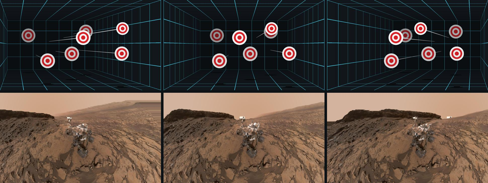

# 100 Days, 100 Projects

I'm [Keshav](https://keshavmarkan.com), a computer science student at Conestoga College. I'm building a project a day and sharing what I learn.

[Explore the portfolio](https://keshavmarkan.com/#folio-series) · [Follow @kaylocksin](https://www.instagram.com/kaylocksin/) · [GitHub profile](https://github.com/marrkann08-max)

## Project index

| Day | Project | What it explores | Code / demo |
| :--- | :--- | :--- | :--- |
| 001 | **Smart Traffic Navigator** | Dijkstra’s shortest path and changing traffic conditions | [Source](projects/001-smart-traffic-navigator) |
| 002 | **Interactive portfolio** | React, TypeScript, an explorable Three.js campus, and Cloudflare Workers + D1 | [Website](https://keshavmarkan.com) · [Source](https://github.com/marrkann08-max/keshav-portfolio) |
| 003 | **Ki Forge** | MediaPipe hand tracking, an OpenCV/NumPy particle renderer, and synthesized sound | [Setup & source](projects/003-ki-forge) |
| 004 | **Opcode Canvas** | Editable x86 assembly, a Python pixel canvas, and instruction stepping | [Setup & source](projects/004-opcode-canvas) |
| 005 | **Descent** | A *Platform*-inspired tower where NumPy neural-net brains evolve greed or sharing via a genetic algorithm | [Setup & source](projects/005-descent) |
| 006 | **Holo Window** | Webcam head tracking and off-axis projection turn a laptop screen into a 3D window; Depth Anything turns photos into scenes | [Setup & source](projects/006-holo-window) |

The portfolio source lives in [keshav-portfolio](https://github.com/marrkann08-max/keshav-portfolio). The other projects are in this repository.

## Latest experiment — Holo Window

Your laptop screen becomes a window. The webcam tracks your eyes and the scene is re-rendered from exactly where you sit, so moving your head lets you look around objects, into the room behind the glass, and past targets floating in front of it. Drop in any photo and a depth model turns it into a 3D scene; press P and your selfie becomes one.



**Python · MediaPipe Face Landmarker · off-axis projection · Depth Anything V2 · ONNX Runtime · OpenGL (moderngl)**

Runs on a laptop CPU with integrated graphics: face tracking at 30 fps, rendering at 60 fps, no NVIDIA GPU.

[Run Holo Window →](projects/006-holo-window/README.md)

## Repository layout

```text
projects/
├── 001-smart-traffic-navigator/   shortest-path traffic simulation
├── 003-ki-forge/                 gesture-controlled energy playground
├── 004-opcode-canvas/            assembly-driven pixel canvas
├── 005-descent/                  evolving greed vs. sharing in a descending-feast tower
└── 006-holo-window/              head-tracked 3D window on a laptop screen
```

## Running a project

Each project has its own dependencies and entry point. Open its folder and follow the setup instructions. Ki Forge, Opcode Canvas, Descent and Holo Window include dedicated READMEs and automated checks; the traffic navigator includes its Python source and experiment outputs.

## About the series

Some projects start with a concept from class; others start with an idea I want to try. Each entry links to the code and any setup instructions.

See the visual trail at **[keshavmarkan.com](https://keshavmarkan.com/#folio-series)**.
