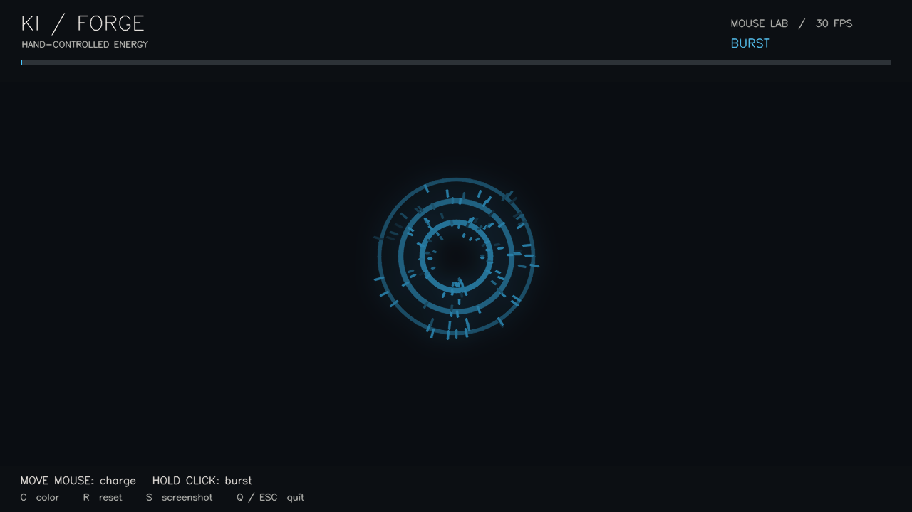

# 100 Days, 100 Projects

I'm [Keshav](https://keshavmarkan.com), a computer science student at Conestoga College. I'm building a project a day and sharing what I learn.

[Explore the portfolio](https://keshavmarkan.com/#folio-series) · [Follow @kaylocksin](https://www.instagram.com/kaylocksin/) · [GitHub profile](https://github.com/marrkann08-max)

## Project index

| Day | Project | What it explores | Code / demo |
| :--- | :--- | :--- | :--- |
| 001 | **Smart Traffic Navigator** | Dijkstra’s shortest path and changing traffic conditions | [Source](projects/001-smart-traffic-navigator) |
| 002 | **Interactive portfolio** | React, TypeScript, an explorable Three.js campus, and Cloudflare Workers + D1 | [Website](https://keshavmarkan.com) · [Source](https://github.com/marrkann08-max/keshav-portfolio) |
| 003 | **Ki Forge** | MediaPipe hand tracking, an OpenCV/NumPy particle renderer, and synthesized sound | [Setup & source](projects/003-ki-forge) |

The portfolio source lives in [keshav-portfolio](https://github.com/marrkann08-max/keshav-portfolio). The other projects are in this repository.

## Latest experiment — Ki Forge

Open a palm to charge an energy ball. Bring two palms together to shape it, then close your fist to compress and burst the particles with trails and shockwaves.



**Python · OpenCV · MediaPipe · NumPy · sounddevice**

Hand tracking runs locally after the model download. A mouse playground lets you try the renderer without a webcam.

[Run Ki Forge →](projects/003-ki-forge/README.md)

## Repository layout

```text
projects/
├── 001-smart-traffic-navigator/   shortest-path traffic simulation
└── 003-ki-forge/                 gesture-controlled energy playground
```

## Running a project

Each project has its own dependencies and entry point. Open its folder and follow the available setup instructions. Ki Forge includes a dedicated README and automated checks; the traffic navigator includes its Python source and experiment outputs.

## About the series

Some projects start with a concept from class; others start with an idea I want to try. Each entry links to the code and any setup instructions.

See the visual trail at **[keshavmarkan.com](https://keshavmarkan.com/#folio-series)**.
