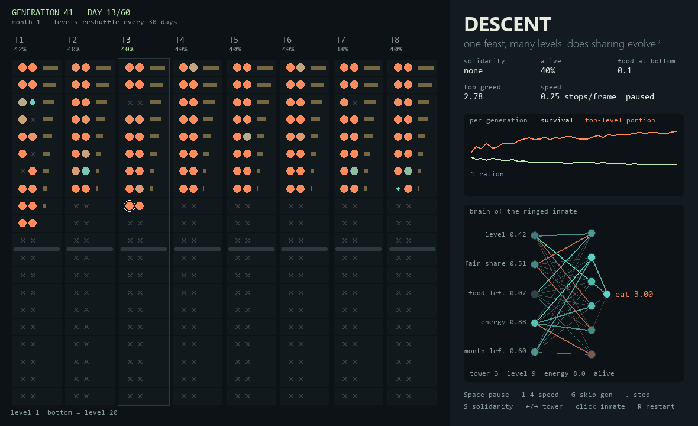

# 100 Days, 100 Projects

I'm [Keshav](https://keshavmarkan.com), a computer science student at Conestoga College. I'm building a project a day and sharing what I learn.

[Explore the portfolio](https://keshavmarkan.com/#folio-series) · [Follow @kaylocksin](https://www.instagram.com/kaylocksin/) · [GitHub profile](https://github.com/marrkann08-max)

## Project index

| Day | Project | What it explores | Code / demo |
| :--- | :--- | :--- | :--- |
| 001 | **Smart Traffic Navigator** | Dijkstra’s shortest path and changing traffic conditions | [Source](projects/001-smart-traffic-navigator) |
| 002 | **Interactive portfolio** | React, TypeScript, an explorable Three.js campus, and Cloudflare Workers + D1 | [Website](https://keshavmarkan.com) · [Source](https://github.com/marrkann08-max/keshav-portfolio) |
| 003 | **Ki Forge** | MediaPipe hand tracking, an OpenCV/NumPy particle renderer, and synthesized sound | [Setup & source](projects/003-ki-forge) |
| 004 | **Opcode Canvas** | Editable x86 assembly, a Python pixel canvas, and instruction stepping | [Setup & source](projects/004-opcode-canvas) |
| 005 | **Descent** | A *Platform*-inspired tower where NumPy neural-net brains evolve greed or sharing via a genetic algorithm | [Setup & source](projects/005-descent) |

The portfolio source lives in [keshav-portfolio](https://github.com/marrkann08-max/keshav-portfolio). The other projects are in this repository.

## Latest experiment — Descent

Inspired by *The Platform*: a feast descends through a tower once a day, with enough food for everyone if no one takes more than their share. Inmates with tiny neural-network brains decide how much to eat, and evolution decides who breeds. Without solidarity, greed evolves and the bottom starves. When selection acts on whole towers, the inmates learn to take turns and almost everyone survives.



**Python · NumPy · neural networks · genetic algorithms · multilevel selection · Pygame**

Watch the platform empty level by level, click any inmate to see its brain decide, and switch solidarity on to see whether sharing can evolve.

[Run Descent →](projects/005-descent/README.md)

## Repository layout

```text
projects/
├── 001-smart-traffic-navigator/   shortest-path traffic simulation
├── 003-ki-forge/                 gesture-controlled energy playground
├── 004-opcode-canvas/            assembly-driven pixel canvas
└── 005-descent/                  evolving greed vs. sharing in a descending-feast tower
```

## Running a project

Each project has its own dependencies and entry point. Open its folder and follow the setup instructions. Ki Forge, Opcode Canvas and Descent include dedicated READMEs and automated checks; the traffic navigator includes its Python source and experiment outputs.

## About the series

Some projects start with a concept from class; others start with an idea I want to try. Each entry links to the code and any setup instructions.

See the visual trail at **[keshavmarkan.com](https://keshavmarkan.com/#folio-series)**.
