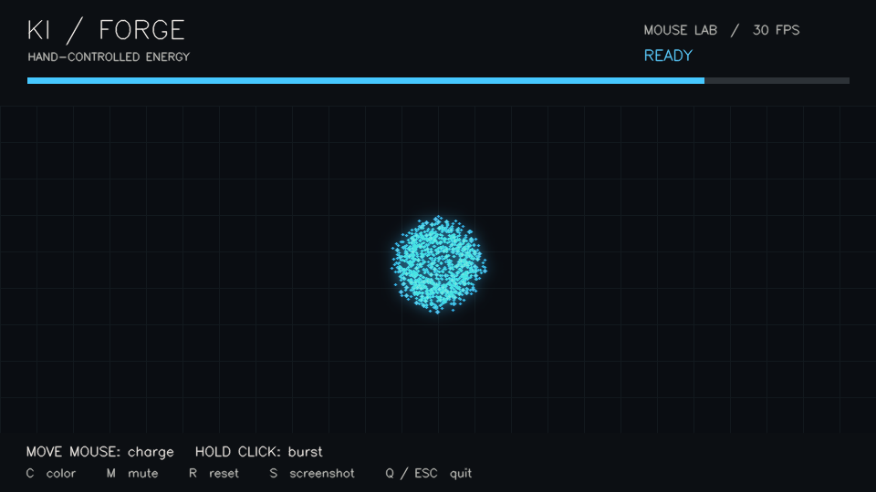

# Ki Forge

**Project 003 / 100 Days, 100 Projects**

Summon a glowing energy ball in your palm, charge it between two hands, then close your fist to launch it across your webcam feed. Inspired by anime energy attacks, built with Python, OpenCV and MediaPipe.



Firing creates an anchored energy beam with a bright core, a travelling head and an expanding shockwave:


## Run

Use Python 3.11 or newer. Tested with Python 3.14 on Windows.

```sh
python -m venv .venv
```

Activate on Windows PowerShell:

```powershell
.venv\Scripts\Activate.ps1
```

Or on macOS / Linux:

```sh
source .venv/bin/activate
```

Then install and launch from this project's folder:

```sh
python -m pip install -r requirements.txt
python -m ki_forge
```

The first webcam run downloads Google's hand landmark model (roughly 8 MB). After that, hand tracking runs locally; webcam frames are not uploaded. Close the app to release the camera. Screenshots are saved only when you press S.

No webcam? Try the mouse playground:

```sh
python -m ki_forge --demo
```

## Controls

| Action | Result |
| --- | --- |
| Show an open palm | Summon and charge an energy ball |
| Hold two open palms near each other | Center the ball between your hands; hand spacing sets its size |
| Close your fist once READY appears | Launch a blast; left half fires left, right half fires right |
| C | Cycle blue, gold and violet energy |
| R | Reset energy and particles |
| S | Save a screenshot in `captures/` |
| Q / Escape | Quit |

In mouse mode, move to steer and charge. Hold the left mouse button briefly to fire once READY appears, then release to recharge. Charging takes about two seconds. Keep your whole hand visible with the palm facing the camera; use even lighting and avoid crossing hands. A short fist debounce reduces accidental blasts. Losing tracking fades the charge and never launches a blast.

## How it works

MediaPipe's Hand Landmarker finds 21 landmarks per hand. Wrist-to-fingertip distances estimate open fingers without relying on the hand pointing upward. A time-based state machine charges, debounces a closed fist, and applies a cooldown. OpenCV composites layered circles, elliptical energy rings, orbiting sparks, bloom and travelling projectiles over a mirrored camera image. The two-hand mode follows the midpoint of the palms.

This is a gesture playground: fist detection is a geometric heuristic, and overlapping hands or extreme angles can confuse it. Effects are screen-space graphics, so they draw over the hand rather than behind fingers.

## Troubleshooting

- Camera busy or unavailable: close other camera apps, enable camera access in your operating system, or try `python -m ki_forge --camera 1`.
- Blank or slow feed: improve lighting and close other camera applications. FPS is shown in the top corner.
- Model download blocked: download the [version 1 hand landmark model](https://storage.googleapis.com/mediapipe-models/hand_landmarker/hand_landmarker/float16/1/hand_landmarker.task), save it as `assets/hand_landmarker.task`, or pass `--model PATH`.
- OpenCV window errors: use a desktop session and the requirements above, rather than a headless OpenCV package. Install only one OpenCV distribution in a clean environment.

## Checks

```sh
python -m unittest discover -s tests -v
python -m ki_forge --preview assets/preview.png
```

The preview checks the rendering path without opening a camera. Automated checks cover charge timing, fist debounce, tracking loss, two-hand placement and reset. Gesture feel still needs a live hand test on your camera.

## References

- [MediaPipe Hand Landmarker Python guide](https://ai.google.dev/edge/mediapipe/solutions/vision/hand_landmarker/python)
- [OpenCV Python documentation](https://docs.opencv.org/4.x/d6/d00/tutorial_py_root.html)

The hand model is downloaded from Google's model hosting and is not included in the repository. No anime artwork or character assets are bundled.
