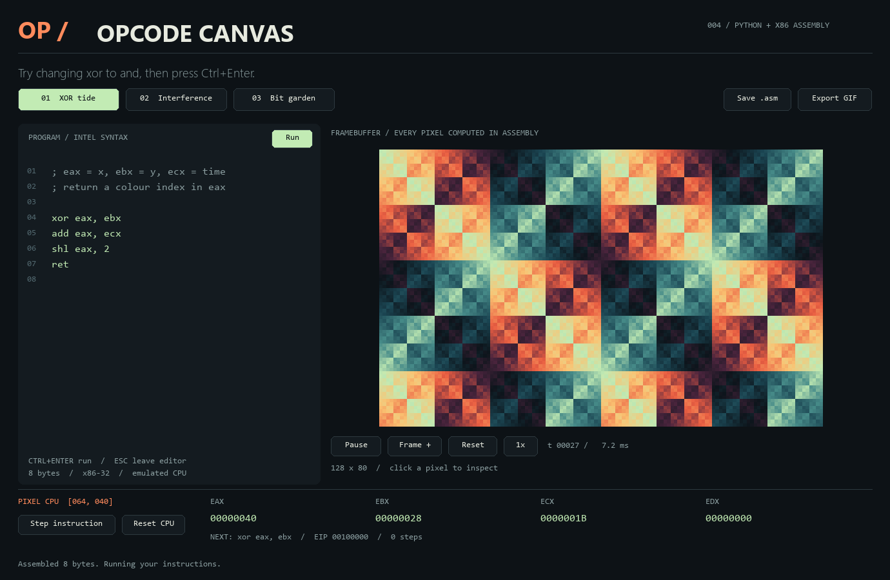

# Day 004 — Opcode Canvas

I wanted to see what a few assembly instructions could draw. This is a Python desktop app where you edit an x86 program and watch it generate an animated pixel canvas.

Change `xor eax, ebx` to `and eax, ebx`, press **Ctrl+Enter**, and the pattern changes. Click a pixel and step through the instructions to see how its colour gets calculated.



## Run it

Python 3.11 or newer. Tested on Windows with Python 3.14.5.

From this folder:

```powershell
python -m venv .venv
.venv\Scripts\python -m pip install -r requirements.txt
.venv\Scripts\python -m opcode_canvas
```

After setup, Windows users can also double-click `run.cmd`.

On macOS/Linux, use `.venv/bin/python` in place of `.venv\Scripts\python`.

## Try these first

1. Start with **XOR tide**. Replace `xor` with `and` and run it.
2. Change `shl eax, 2` to `shl eax, 3` and compare the pattern.
3. Choose **Interference** or **Bit garden** for different integer patterns.
4. Click the canvas to pause and select a pixel. Press **Step instruction** to execute one instruction. Changed registers turn orange; the next instruction appears below them.
5. Press **Export GIF** to save 48 frames in `exports/`. **Save .asm** saves your editor contents there too.

The editor supports arrow keys, Home/End, Backspace/Delete, Tab, Ctrl+Z, Ctrl+V, and Ctrl+C. Copy copies the whole program. Escape leaves the editor; Space then toggles playback. **Frame +** advances one time step, **Reset** returns time to zero, and the speed button changes the time increment.

Edits take effect when you press **Run** or **Ctrl+Enter**. A star on Run means the editor has changes that haven't been assembled. If assembly fails, the last working program stays loaded.

## How it works

```text
Assembly source → Keystone → x86 machine code → Unicorn → pixel indices
                                                           ↓
                                             NumPy palette → Pygame window
```

The assembly runs in an **emulated x86-32 CPU**. Python supplies the coordinates and time, calls your program for each of the 128 × 80 pixels, and maps the result to a fixed colour palette. Capstone disassembles the next instruction in the pixel debugger. GIF export uses the same assembly renderer.

This isn't a Python formula parser dressed up as assembly, and it doesn't run natively on the host CPU or measure hardware cycles.

### Pixel program contract

| Register | On entry |
| --- | --- |
| `EAX` | x coordinate, 0–127 |
| `EBX` | y coordinate, 0–79 |
| `ECX` | integer animation time |
| `EDX` | zero |

Return the colour index in the low eight bits of `EAX` (`AL`), then execute `ret`. Arithmetic uses 32-bit register values; the final colour wraps to 0–255. Scratch registers may change. Keep the stack balanced and don't depend on other initial registers, flags, or memory.

```asm
; x XOR y, animated by time
xor eax, ebx
add eax, ecx
shl eax, 2
ret
```

The frame runner has a 60 ms execution timeout and a two-million-instruction limit. Invalid instructions, unmapped memory, missing returns, and runaway loops produce an error instead of hanging the render loop. Rendering and GIF export run outside the UI thread. These are execution limits, not a general-purpose security sandbox.

The stepper executes the selected pixel independently; it doesn't trace every pixel in a full frame. The GUI caps playback at 30 FPS, with actual throughput depending on the program and computer.

## Command-line options

```powershell
python -m opcode_canvas --preset 2
python -m opcode_canvas --load exports/my-program.asm
python -m opcode_canvas --export-gif exports/animation.gif
python -m opcode_canvas --screenshot exports/window.png
python -m unittest discover -s tests -v
```

Screenshot and GIF commands can run without a visible window. Exports are local; the app needs no account, camera, API key, or internet connection after dependencies are installed.


## References

- [franeklubi/dino](https://github.com/franeklubi/dino): a 512-byte assembly game that got me interested in small visual programs.
- [x86-64 Playground](https://github.com/robalb/x86-64-playground): an assembly editor, emulator, and debugger.
- [JuniEmu](https://github.com/arkup/juniEmu): register and memory inspection around Unicorn emulation.
- Libraries: [Keystone](https://github.com/keystone-engine/keystone), [Unicorn](https://github.com/unicorn-engine/unicorn), [Capstone](https://github.com/capstone-engine/capstone), [pygame-ce](https://github.com/pygame-community/pygame-ce), NumPy, and Pillow.

This implementation uses those libraries; it doesn't copy the example projects' source.
