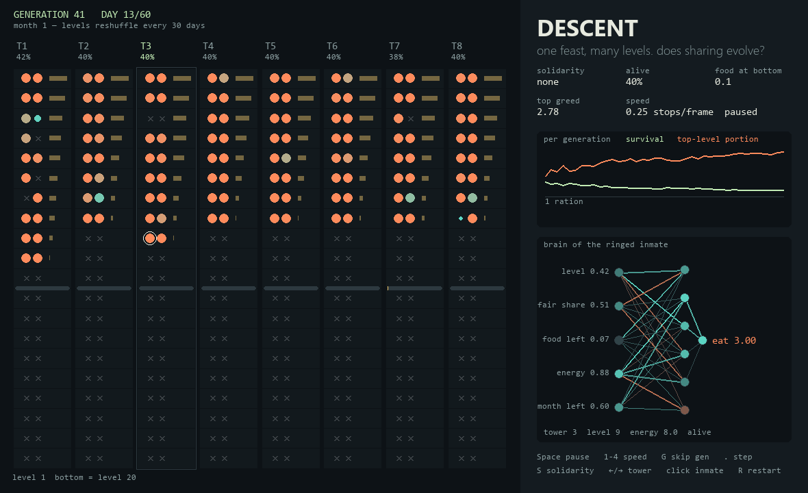
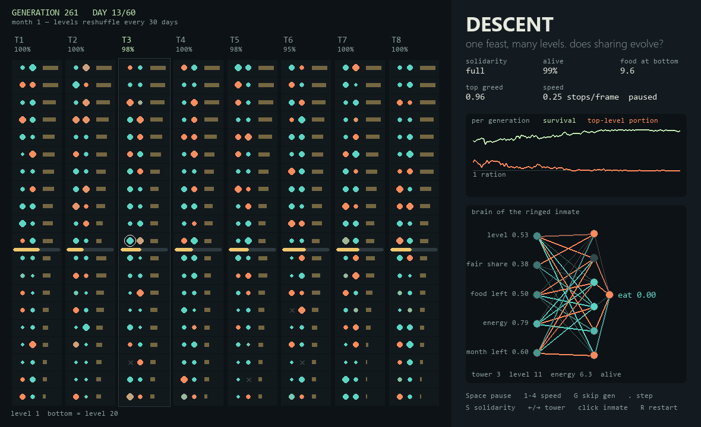

# Day 005 — Descent

After watching *The Platform* (*El Hoyo*, 2019), I wanted to test its question with evolution instead of a story: if everyone would have enough by taking only their share, does sharing ever emerge, or does greed always win?

Descent is a Python desktop app. Eight towers each hold 40 inmates, two per level across 20 levels. Once a day a feast is loaded at the top with 10% more food than everyone needs, and it descends one level at a time. At each stop, the inmates' small neural-network brains decide how much to eat. Every 30 days, everyone wakes up on a random level.

Nobody programs the inmates' behaviour. It evolves.



## Run it

Python 3.11 or newer. Tested on Windows with Python 3.14.5.

From this folder:

```powershell
python -m venv .venv
.venv\Scripts\python -m pip install -r requirements.txt
.venv\Scripts\python -m descent
```

After setup, Windows users can also double-click `run.cmd`.

On macOS/Linux, use `.venv/bin/python` in place of `.venv\Scripts\python`.

## Try these first

1. Press **4** and let a few dozen generations run. Greed climbs (orange line), and the bottom of every tower fills with crosses.
2. Press **S** twice for **full solidarity**, then keep it running. It usually takes 150–300 generations, so use **G** to skip ahead. The orange line falls towards one ration and survival climbs.
3. Press **1** to slow down and watch the gold platform empty as it descends. The bars beside each level show how much food arrived there.
4. Click any inmate to see its brain. The panel shows what it sensed and how much it decided to eat.

| Key | Action |
| --- | --- |
| Space | Pause / resume |
| 1–4 | Platform speed: ¼, 2, 20, 200 stops per frame |
| G | Finish the current generation instantly |
| . | Advance one stop while paused |
| S | Cycle solidarity: none → partial → full |
| ← / → | Choose a tower |
| Click | Inspect an inmate's brain |
| R | Restart with random brains (keeps the solidarity setting) |

**Colours:** teal inmates took about one ration or less at their last meal; orange ones took up to the three-ration maximum. Dot size is stored energy. A grey cross means the inmate starved.

## What happens

Results from headless runs (`--headless`), averaged over the last 10 generations:

| Setting | Generations | Survival | Portion at top levels |
| --- | --- | --- | --- |
| No solidarity | 120 | ~42% | ~2.9 rations |
| Full solidarity | 300 | ~97% | ~1.0 ration |

**With no solidarity, greed wins.** Inside a tower, the inmates who survive longest breed. Eating as much as possible at the top builds a reserve for the month you'll spend near the bottom, so greedy brains out-survive restrained ones even though the tower as a whole does worse. That's the tragedy of the commons.

**With full solidarity, sharing evolves, slowly.** Selection moves from the individual to the tower: towers where more people survive replace the ones where many starve. The inmates didn't evolve the rule I expected, "always take exactly one ration". Instead they take turns: an inmate with a full reserve skips the meal (eats 0), and a hungry one eats big. It averages out to about one ration each and keeps nearly everyone alive.



## How it works

```text
5 senses → 6 hidden neurons → portion to eat (0–3 rations)
                                   ↓
     platform descends level by level, emptying as it goes
                                   ↓
   end of day: everyone burns 1 ration; empty reserve = starved
                                   ↓
   after 60 days: selection inside towers (+ between towers with solidarity)
```

**The brain** is a 5 → 6 → 1 network with tanh activations, written in NumPy. Its 43 weights and biases are the inmate's genome. There's no backpropagation; only evolution changes the weights. All brains at a stop run in one batched call.

| Sense | Meaning |
| --- | --- |
| level | How far down the inmate is (0 = top, 1 = bottom) |
| fair share | Food on the platform ÷ living inmates from here down |
| food left | Food on the platform as a fraction of the original feast |
| energy | Stored reserve (0–8 rations) |
| month left | Time until the next reshuffle |

**The rules.** An inmate starts with 4 rations stored and can hold up to 8. Each day costs 1 ration. If the two inmates on a level ask for more than is left, it's split in proportion. A generation lasts 60 days (two reshuffles).

**Evolution.** Each tower breeds separately: the 2 longest survivors are copied unchanged, and the rest are children of 3-way tournament winners. Each gene comes from either parent at random, and 12% of genes are mutated. Solidarity *s* changes two things:

- A fraction *s* of parents is chosen regardless of personal score, so your fate depends less on you and more on your tower.
- The worst *s* × 4 towers are replaced by mutated copies of the best ones.

Biologists call this **multilevel selection**: selection between individuals favours greed, while selection between groups favours restraint.

### Limits

It's an abstract model of one idea, not a model of real people. Inmates can't talk, punish greed, or remember each other. They only react to what's on the platform. Solidarity here is a selection rule imposed from outside, not something the inmates choose. Results vary by seed, and sharing sometimes takes much longer to appear.

## Command-line options

```powershell
python -m descent --seed 3                            # repeat an exact run
python -m descent --solidarity 1 --train 200          # evolve 200 generations, then open the window
python -m descent --train 100 --headless              # print a per-generation table and exit
python -m descent --train 40 --screenshot exports/window.png
python -m unittest discover -s tests -v
```

The app needs no account, camera, API key, or internet connection after dependencies are installed.

## References

- *The Platform* (*El Hoyo*), dir. Galder Gaztelu-Urrutia, 2019: the premise this simulation explores.
- Garrett Hardin, ["The Tragedy of the Commons"](https://www.science.org/doi/10.1126/science.162.3859.1243), *Science*, 1968.
- D. S. Wilson & E. O. Wilson, ["Rethinking the theoretical foundation of sociobiology"](https://doi.org/10.1086/522809), *Quarterly Review of Biology*, 2007: an overview of multilevel selection.
- Libraries: NumPy and [pygame-ce](https://github.com/pygame-community/pygame-ce).

This is an original simulation inspired by the film's premise. It doesn't use any of the film's footage, characters, or artwork.
