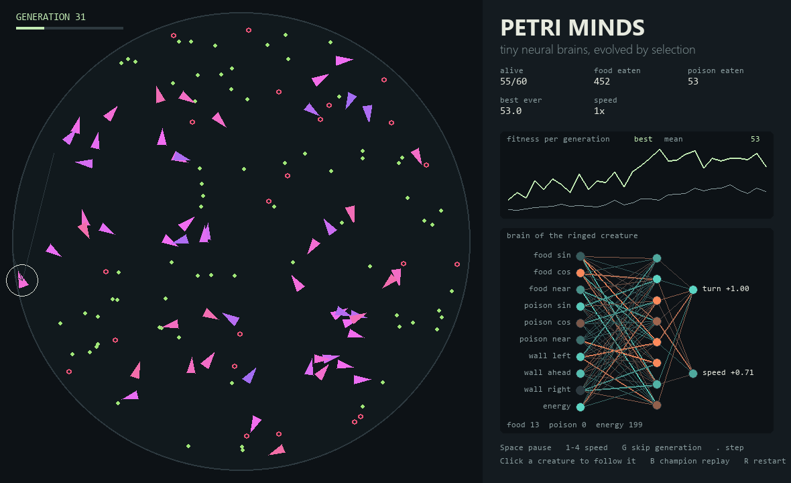
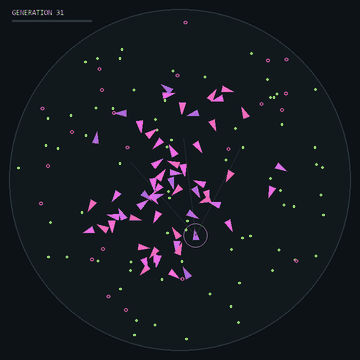

# Day 005 — Petri Minds

I wanted to watch behaviour evolve instead of programming it by hand. This is a Python desktop app where 60 creatures, each with a tiny neural-network brain, compete for food in a petri dish. The best foragers become the parents of the next generation.

Generation 1 mostly spins in circles or swims straight into the wall. Within about 20 generations, many creatures steer towards food and turn away before reaching the wall.



## Run it

Python 3.11 or newer. Tested on Windows with Python 3.14.5.

From this folder:

```powershell
python -m venv .venv
.venv\Scripts\python -m pip install -r requirements.txt
.venv\Scripts\python -m petri_minds
```

After setup, Windows users can also double-click `run.cmd`.

On macOS/Linux, use `.venv/bin/python` in place of `.venv\Scripts\python`.

## Try these first

1. Press **4** to run at 40× speed and watch the fitness graph climb for a few generations.
2. Click a creature to follow it. The brain panel shows its neurons firing as it moves.
3. Press **B** to replay the last generation's champion alone in a fresh dish. Press **B** again to go back.
4. Press **G** to skip straight to the next generation, or **R** to restart from random brains.
5. Pause with **Space** and press **.** to advance one step at a time.

| Key | Action |
| --- | --- |
| Space | Pause / resume |
| 1–4 | 1×, 4×, 12×, 40× simulation speed |
| G | Finish the current generation instantly |
| . | Step once while paused |
| Click | Follow a creature (its brain appears in the panel) |
| B | Champion replay on / off |
| R | Restart with new random brains |

## How it works

```text
10 sensors → 8 hidden neurons → 2 outputs (turn, speed)
      ↑                                   ↓
   the dish  ←─────── move, eat, spend energy
                                          ↓
  fitness → selection → crossover + mutation → next generation
```

**The brain.** Each creature's brain is a fully connected network, 10 → 8 → 2 with tanh activations, written in NumPy. Its 106 weights and biases are stored as one flat array: the creature's genome. No gradient descent or backpropagation is involved; the weights change only through evolution.

**The senses.** Each step a creature sees:

| Input | Meaning |
| --- | --- |
| food sin, food cos | Direction to the nearest food, relative to where it's facing |
| food near | How close that food is (0 = out of sight, 1 = touching) |
| poison sin, cos, near | The same for the nearest poison pellet |
| wall left / ahead / right | How close the dish edge is along three rays |
| energy | Remaining energy |

**The rules.** Moving costs energy, and faster movement costs more. Green food gives +35 energy; red poison rings take 45. A creature dies if it touches the dish wall or runs out of energy. Each generation lasts 900 steps.

**Evolution.** Fitness is `food − 1.5 × poison + 0.5 × fraction of the generation survived`. The top 4 brains are copied unchanged (elitism). Each remaining slot is filled by a child of two parents chosen by 3-way tournaments. Each gene comes from either parent at random, and 12% of genes get Gaussian noise. Children inherit their mother's colour with slight drift, so you can watch a successful lineage take over the dish.

All 60 brains run in one batched NumPy call per step (`einsum`), so a full 900-step generation takes under a second headless.

### What it doesn't do

The creatures don't learn during their lifetime; only selection between generations changes their behaviour. Runs are noisy, because everyone shares one dish and pellets respawn at random. A champion may score lower in its replay than in the generation where it won. Poison avoidance evolves more slowly than food-seeking, and some runs never really learn it.

## Command-line options

```powershell
python -m petri_minds --seed 5                # repeat an exact run
python -m petri_minds --train 30              # evolve 30 generations, then open the window
python -m petri_minds --train 50 --headless   # print a per-generation table and exit
python -m petri_minds --train 30 --screenshot exports/window.png
python -m unittest discover -s tests -v
```

Headless and screenshot modes don't open a window. The app needs no account, camera, API key, or internet connection after dependencies are installed.



## References

- [Karl Sims, *Evolving Virtual Creatures* (1994)](https://www.karlsims.com/papers/siggraph94.pdf): the classic demonstration of evolving bodies and brains together.
- [NEAT](https://nn.cs.utexas.edu/downloads/papers/stanley.ec02.pdf) (Stanley & Miikkulainen): evolves network structure as well as weights; this project evolves weights only.
- [The Bibites](https://www.thebibites.com/) and [Evolv.io](https://github.com/evolvio/evolv.io): artificial-life sims with neural-net creatures.
- Libraries: NumPy and [pygame-ce](https://github.com/pygame-community/pygame-ce).

This implementation is written from scratch; it doesn't copy those projects' source.
