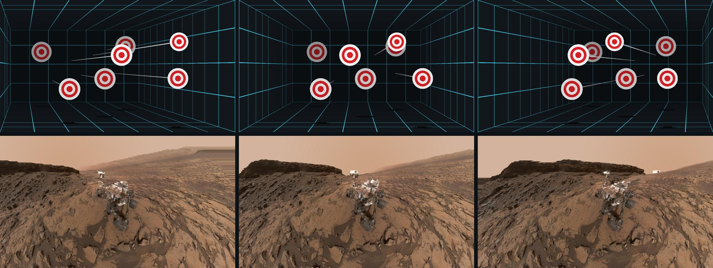
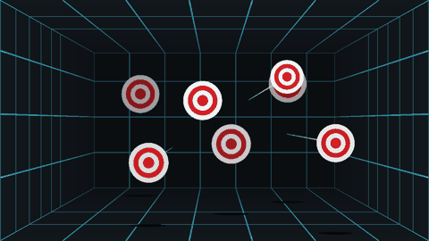

# Day 006 — Holo Window

Your laptop screen becomes a window. The webcam tracks your eyes, and the scene is re-rendered from exactly where you're sitting, so moving your head lets you look *around* things, *into* the room behind the glass, and *past* objects floating in front of it. No glasses and no special hardware: just the webcam that's already there.

Drop in any photo and a depth AI turns it into a 3D scene you can peer into. Press **P** and your own selfie becomes one.



*Each row shows the same scene from three head positions. The screen's edges stay fixed, and everything behind them shifts the way a real window would.*

## Run it

Python 3.11 or newer, a webcam, and OpenGL 3.3. Tested on Windows 11 with Python 3.14.5 on an AMD Ryzen 7 5825U laptop with integrated Radeon graphics: no NVIDIA GPU needed.

From this folder:

```powershell
python -m venv .venv
.venv\Scripts\python -m pip install -r requirements.txt
.venv\Scripts\python -m holo_window
```

After setup, Windows users can also double-click `run.cmd`. The first run downloads two models into `models/`: MediaPipe Face Landmarker (3.8 MB) and Depth Anything V2 Small (99 MB).

On macOS/Linux, use `.venv/bin/python` in place of `.venv\Scripts\python`. Physical screen size is auto-detected on Windows only; elsewhere, set it in `config.json`.

## Getting the illusion

1. **Sit 40–70 cm away**, roughly centred, with your face lit from the front.
2. **Close one eye.** Your brain judges depth from both eyes and knows the screen is flat; with one eye, motion parallax is the only depth cue left, and the window effect becomes startling.
3. **Move your head slowly** side to side and up and down, then lean in. Look into the corners of the box room, and watch the targets that float *in front* of the screen slide the opposite way.
4. **Calibrate once.** Sit with your eyes 50 cm from the screen (use a ruler), press **C**, look at the screen, and press **C** again. This measures your webcam's field of view, so distances are in real centimetres. It's saved to `config.json`.

**Filming it:** the illusion only works from the tracked eye. To record it for others, hold your phone right beside your face with its lens near one eye. The app follows your head, and the phone sees what that eye sees.

| Key | Action |
| --- | --- |
| ← / → or Tab | Switch scene |
| Drag & drop | Open any photo as a 3D window |
| P | 3D selfie from the webcam |
| [ / ] | Flatter / deeper photo |
| C | Calibrate (sit 50 cm away, press twice) |
| M | Mouse mode: move the mouse to move your viewpoint |
| H | Hide the panel |
| Esc | Quit |

## How it works

```text
webcam 640×480 @ 30 fps
   → MediaPipe Face Landmarker (478 landmarks incl. irises, ~11 ms on CPU)
   → eye position in cm (similar triangles) → One Euro filter + 30 ms prediction
   → off-axis projection: the screen is a fixed window, the eye is the camera
   → OpenGL (moderngl) at 60 fps
```

### 1. Where are your eyes, in centimetres?

The pupils of an adult are about 6.3 cm apart. If they appear *g* pixels apart in a camera with focal length *f* pixels, your distance is *f* × 6.3 / *g*, by similar triangles. The point between your irises then gives the direction, and together they give a 3D position relative to the camera. That's converted to screen coordinates, with the origin at the centre of the screen, using the camera's offset above the display.

Two details make it robust:
- The gap is measured in 3D using MediaPipe's per-landmark depth, so turning your head doesn't make you look further away.
- The camera image is a mirror of you: moving right moves your face left in the frame.

### 2. Off-axis projection

A normal 3D camera has a symmetric view frustum. Here the frustum's edges must pass through the four physical corners of the screen, wherever your eye is. Move your head left and the frustum skews right.

That's `glFrustum` with asymmetric bounds (Kooima's "generalized perspective projection"), rebuilt every frame from the tracked eye. The tests check the defining property: for any eye position, the screen's corners land exactly on the corners of the image.

### 3. Photos into 3D

Depth Anything V2 Small estimates relative depth for each pixel in about 0.6 s on the CPU. The photo becomes a 256-column grid mesh, and each vertex is pushed back along the ray from a centred viewer. From the centre, the photo therefore looks exactly like the original; move and the near parts slide over the far ones.

Triangles that span a big depth jump (such as the edge of the rover against the sky) are dropped rather than stretched. A flat copy of the photo placed just behind everything fills the gaps with plausible background, the same disocclusion problem VR photo apps have to solve.

### 4. Smoothness

- **Jitter:** a One Euro filter smooths when you're still (about ±0.5 cm) and gets out of the way when you move fast.
- **Latency:** the filter's velocity estimate is used to predict 30 ms ahead, hiding part of the camera's lag.
- **Threads:** face tracking and depth estimation run on background threads, and depth estimation is capped at half the CPU cores, so the render loop holds 60 fps even while a photo is being converted.

## Command-line options

```powershell
python -m holo_window path\to\photo.jpg               # open your own photos as windows
python -m holo_window --mouse                         # no webcam: the mouse moves your head
python -m holo_window --windowed --camera 1           # run in a window, use another camera
python -m holo_window --screenshot exports\views.png  # left/centre/right views, offscreen
python -m holo_window --export-gif exports\sweep.gif  # head-sweep animation, offscreen
python -m unittest discover -s tests -v
```

Everything runs locally. Camera frames are never saved or sent anywhere; a 3D selfie only lives in memory until you quit.



## Limits

- It's one viewer, one viewpoint. Anyone else watching sees a distorted image.
- Your two eyes see the same picture (there's no stereo), which is why closing one eye helps so much.
- Depth from a single photo is a learned guess at *relative* depth. Glass, mirrors, thin structures and skies can come out wrong. Use **[** and **]** to tune how deep a photo feels.
- Laptop webcams add some latency. Very fast head movements will feel like the scene catches up a beat late.
- Accuracy depends on calibration and on the default 6.3 cm pupil distance; change `ipd` in `config.json` if yours differs.

## References

- Johnny Chung Lee, [*Head Tracking for Desktop VR Displays using the Wii Remote*](https://www.youtube.com/watch?v=Jd3-eiid-Uw) (2007): the demo that made this effect famous.
- Robert Kooima, *Generalized Perspective Projection* (2009): the off-axis projection maths.
- Casiez, Roussel & Vogel, [*1€ Filter*](https://gery.casiez.net/1euro/) (CHI 2012): the smoothing filter.
- [Depth Anything V2](https://github.com/DepthAnything/Depth-Anything-V2) (Yang et al., 2024). The Small model is Apache-2.0; the ONNX export is from [onnx-community](https://huggingface.co/onnx-community/depth-anything-v2-small).
- [MediaPipe Face Landmarker](https://ai.google.dev/edge/mediapipe/solutions/vision/face_landmarker) (Apache-2.0).
- Sample photo: *Curiosity Self-Portrait at Murray Buttes* ([PIA20844](https://photojournal.jpl.nasa.gov/catalog/PIA20844)), NASA/JPL-Caltech/MSSS, public domain.
- Libraries: [moderngl](https://github.com/moderngl/moderngl), [pygame-ce](https://github.com/pygame-community/pygame-ce), ONNX Runtime, OpenCV, NumPy and Pillow.

This implementation is written from scratch; it doesn't copy code from the projects above.
