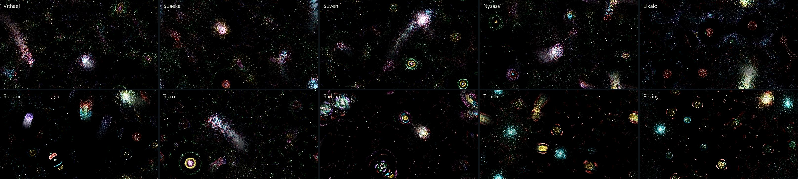
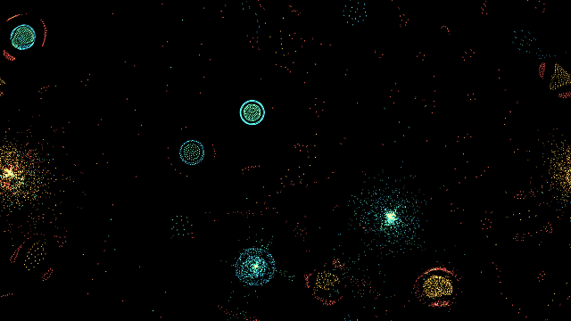

# Day 007 — Primordial

Thousands of coloured particles, one simple rule: each colour is attracted to or repelled by each other colour. From that alone come cells with membranes, swimming worms, orbiting rings and colonies that split and merge. Nobody designs them.

Instead of hand-tuning rules until something interesting happens, Primordial lets **evolution find them**. It runs hundreds of random rule sets, scores each on how *alive* it looks, breeds the best, and adds the winners to a gallery of species.



## Run it

Python 3.11 or newer and a GPU with OpenGL 4.3 (any recent integrated graphics works). Tested on Windows 11 with Python 3.14.5 on an AMD Ryzen 7 5825U with integrated Radeon graphics.

From this folder:

```powershell
python -m venv .venv
.venv\Scripts\python -m pip install -r requirements.txt
.venv\Scripts\python -m primordial
```

After setup, Windows users can also double-click `run.cmd`.

On macOS/Linux, use `.venv/bin/python` in place of `.venv\Scripts\python`. macOS only supports OpenGL 4.1, so the compute shader won't run there.

## Try these first

1. Use **←/→** to browse the ten built-in species, all found by the search.
2. **Drag** across the screen to stir; **right-drag** pulls particles together. Watch organisms break apart and re-form.
3. Click cells in the **rule matrix** to change one attraction while the world keeps running. Green attracts and red repels. Row is the particle being pulled, column is what pulls it. Changing one cell can turn a calm colony into a swarm of hunters.
4. Press **D** to discover new species. In about 70 seconds, evolution tests 57 rule sets in the background while the window keeps running. A live graph shows the best and average score per generation, and the winners are added to the gallery.
5. Press **R** for random rules to see how rarely randomness alone looks alive.

| Key | Action |
| --- | --- |
| ← / → | Previous / next species |
| Drag / right-drag | Push / pull particles |
| Click matrix | +0.1 attraction (right-click −0.1, Shift ×5) |
| D | Start / stop discovery |
| R | Random species |
| S | Save the current species to `species/discovered/` |
| C | Reset particle positions |
| T | Trails on / off |
| 1–4 | 4,000 / 8,000 / 12,000 / 16,000 particles |
| Space | Pause |
| H | Hide the panel |

## How it works

### The physics

Each species is an *n* × *n* matrix with values from −1 to 1, plus a few constants. Within a radius *r*, every pair of particles feels a force that depends only on their colours and distance:

- **Closer than 0.3 *r*:** always repel, so particles never collapse into a point.
- **From 0.3 *r* to *r*:** attract or repel by the matrix value, rising then falling in a triangle.
- **Beyond *r*:** nothing.

Velocities lose half their speed every 40 ms (friction), and the world wraps around at the edges.

The matrix doesn't have to be symmetric: red can chase green while green flees red. That asymmetry breaks Newton's third law, and it's where the life-like motion comes from.

### On the GPU

Every particle interacts with every other one: 8,000 particles means 64 million pairs per step. An OpenGL **compute shader** handles this in tiles: each workgroup of 256 threads loads 256 particles into fast shared memory at a time. 8,000 particles take about 3 ms per step on integrated Radeon graphics, so the simulation runs at 60 fps with headroom.

`physics.py` is the same maths in about 30 lines of NumPy. The tests check that the GPU matches it to within 1e-5 after several steps.

Particles are drawn as glowing points with additive blending, into a texture that fades by 18% each frame. That gives the trails.

### Discovering species

`lifeness.py` turns two snapshots of a world, 200 steps apart, into numbers:

| Measure | What it detects | Why it matters |
| --- | --- | --- |
| Clumping | Variance of particle density compared with a random gas | Gas = nothing formed |
| Organisms | Connected dense regions on a grid | One giant blob isn't an ecosystem |
| Captured | Share of particles inside organisms | Most matter should be organised |
| Mixing | Colour entropy inside organisms | Cells with membranes and cores beat single-colour clumps |
| Travel | How far particles move | Frozen crystals aren't alive |

The **life score** is their product, so a world must do well on all of them at once.

`discover.py` runs a genetic algorithm over rule matrices:
1. Each candidate gets a fresh 2,000-particle world, 500 steps to settle, then 200 steps of measuring.
2. The top 4 survive.
3. Children take whole rows from two parents (a row is one colour's complete behaviour), then get mutated.
4. A few brand-new random species join every generation to keep exploring.

The ten bundled species came from three headless runs (`--discover 8 --seed 7`, `21` and `99`) of 100 candidates each. In the seed-7 run, the best score rose from 0.50 to 0.59 and the population average from 0.29 to about 0.38 within three generations, then plateaued. Each species' stored score is its average over six fresh random starts, not the lucky run that found it.

In the app, the search runs in a few milliseconds per frame between drawing. It waits for the GPU after each small chunk so it never steals more than its budget, and the window stays at 60 fps throughout.



## Command-line options

```powershell
python -m primordial --species Thaith                # start on a species
python -m primordial --particles 16000 --windowed
python -m primordial --discover 8 --seed 5           # headless search, prints a table, saves the best 5
python -m primordial --gallery exports\gallery.jpg   # render every species into one image
python -m primordial --export-gif exports\a.gif --species Suven
python -m unittest discover -s tests -v
```

## Limits

- The life score is hand-designed. It finds what *I* told it life looks like (organised, mixed, moving clusters) and will miss other kinds of interesting behaviour, such as large-scale waves.
- Scores are noisy. The same rules from a different random scatter typically vary by about ±0.1, and occasionally much more (one species ranged from 0.21 to 0.59), so the search sometimes keeps a lucky one. Averaging several starts per candidate would fix this at twice the cost.
- Behaviour depends on density. Discovery uses 2,000 particles in a proportionally smaller world, and most species carry over to 8,000, but not all.
- Brute force is O(n²). Past about 16,000 particles a spatial grid would be needed.

## References

- Jeffrey Ventrella, [*Clusters*](https://www.ventrella.com/Clusters/): the original particle-life idea.
- Tom Mohr, [particle-life-app](https://github.com/tom-mohr/particle-life-app): the force profile and friction model used here.
- Kumar et al., [*Automating the Search for Artificial Life with Foundation Models*](https://arxiv.org/abs/2412.17799) (Sakana AI, 2024): searched particle-life and other artificial-life worlds using a vision model as the judge. Primordial does a much smaller version of that search with a hand-built score.
- Libraries: [moderngl](https://github.com/moderngl/moderngl), [pygame-ce](https://github.com/pygame-community/pygame-ce), NumPy and Pillow.

This implementation is written from scratch; it doesn't copy code from the projects above.
