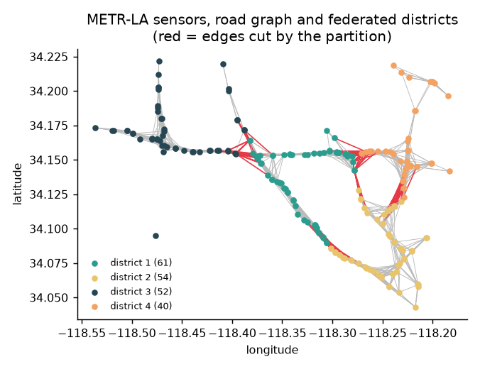

# Day 008 — Federated Traffic Forecasting

Can four city districts train one traffic-forecasting model **without sharing their sensor data**? And what does that cost in accuracy, bandwidth and privacy?

This is a small research project:
- a real dataset (METR-LA: 207 Los Angeles freeway sensors, 4 months, every 5 minutes);
- graph and recurrent neural networks written from scratch in PyTorch;
- federated learning with **Flower**, both simulated and as a real multi-process deployment;
- every result logged, reproducible and written up as a paper.

**→ Read the report: [paper/report.md](paper/report.md)**



## Headline results

| Question | Answer |
|---|---|
| GRU or LSTM? | With the road graph, LSTM wins slightly at every horizon (MAE 2.98 / 3.54 / 4.32 mph at 15 / 30 / 60 min). Without it they tie. |
| Does the road graph help? | Yes, most at long horizons: −6% MAE at 60 minutes for both encoders. |
| Federated vs centralised? | FedAvg is 2.8% worse than pooling all the data (3.654 vs 3.556), and only 0.6 of that comes from losing road links between districts. |
| Is collaboration worth it? | Not with one shared model. Each district training alone is best (3.507), because districts differ a lot. FedProx, which pulls districts together, does worse. |
| Communication trade-offs? | 8-bit updates cut traffic by 37% at no accuracy cost. More local epochs or half the districts per round reach the target with up to 2.5× less communication. |
| Differential privacy? | Unaffordable with 4 districts: noise giving meaningful privacy (ε ≈ 10–23) destroys the model. |
| Simulation vs real deployment? | A real SuperLink + 4 SuperNode run matches the simulation to within 0.0002 mph. |
| Honest limit | Under a laptop-CPU budget, a simple historical average still beats every neural model at 60 minutes. |

## How this maps to the work

| Research task | Where it lives |
|---|---|
| Prepare, clean and analyse a large spatio-temporal transportation dataset | `fedtraffic/data.py`, `fedtraffic/eda.py`, `results/eda.json`, Figures 1–4 |
| Reproducible preprocessing pipeline | one YAML config; chronological split; training-only statistics; checksummed raw data; cache keyed by config + checksums |
| Graph and recurrent neural-network components | `fedtraffic/models.py`: diffusion graph convolution, graph-GRU and graph-LSTM cells, plain GRU/LSTM, graph-only model |
| Federated learning experiments with Flower | `fedtraffic/federated.py` (ClientApp / ServerApp, FedAvg, FedProx, update compression, DP) and `deploy/` (real SuperLink + SuperNodes) |
| Subtask: benchmarking recurrent encoders | `experiments benchmark`: 5 encoders × 3 seeds + 2 baselines (Table 1) |
| Subtask: convergence and communication trade-offs | `experiments tradeoffs`: local epochs, participation, partition, 16/8-bit uploads, FedProx (Table 3, Figures 8–9) |
| Evaluate models and document results | masked MAE / RMSE / MAPE per horizon (`metrics.py`); `report.py` generates every table and figure from the logs |
| Experiment logs and version-controlled code | `runs/`: each run has its config, git commit, dirty flag, versions, seed and per-epoch/round metrics. 40 runs, 0 with uncommitted changes. |
| Figures, tables and the manuscript | `results/`, [paper/report.md](paper/report.md) |
| Research meetings and communication | [RESEARCH_LOG.md](RESEARCH_LOG.md): dated entries, incidents, decisions, questions for discussion |
| Problem formulation and project planning | [PLAN.md](PLAN.md): research questions, milestones, risks, compute budget |
| Research ethics and data stewardship | [DATA_CARD.md](DATA_CARD.md), privacy experiment (RQ5), safe loading, discarded runs kept rather than deleted |

## Run it

Needs Windows/macOS/Linux and about 2 GB for PyTorch. On Windows, Flower's simulator needs **Python 3.12** (Ray has no Windows build for 3.13+). [uv](https://docs.astral.sh/uv/) installs it into the project without touching your system Python.

```powershell
uv python install 3.12
uv venv --python 3.12 .venv
uv pip install --python .venv\Scripts\python.exe -r requirements.txt
.venv\Scripts\python -m unittest discover -s tests       # 21 tests
.venv\Scripts\python -m fedtraffic.eda                   # downloads + verifies the data, exploratory figures
```

Then the experiments, each resumable (finished runs are skipped):

```powershell
.venv\Scripts\python -m fedtraffic.experiments benchmark   # ~50 min on a laptop CPU
.venv\Scripts\python -m fedtraffic.experiments federated   # ~55 min
.venv\Scripts\python -m fedtraffic.experiments tradeoffs   # ~40 min
.venv\Scripts\python -m fedtraffic.experiments privacy     # ~30 min
.venv\Scripts\python deploy\run_local.py                   # real Flower federation, ~2 min
.venv\Scripts\python -m fedtraffic.report                  # regenerate every table and figure
```

Every setting is in `configs/default.yaml`. The sweeps keep the machine awake while they run, and each Flower simulation runs in its own process with a timeout, so one hung run can't stall the rest.

## Project layout

```text
configs/default.yaml      every setting
fedtraffic/
  data.py                 download + checksums, cleaning, graph, splits, windows
  eda.py                  exploratory statistics and figures
  models.py               diffusion convolution, graph-GRU/LSTM, baselines
  train.py                centralised training and masked evaluation
  partition.py            k-means districts, cut-edge measurement
  federated.py            Flower ClientApp/ServerApp, FedAvg/FedProx, compression, DP
  privacy.py              ε from Rényi-DP composition
  tracking.py             run logging tied to git
  experiments.py          the named sweeps
  report.py               tables, figures, summary.json from the logs
deploy/                   Flower App + local SuperLink/SuperNode launcher
runs/                     one folder per experiment run (config, run.json, log.jsonl)
runs_discarded/           runs invalidated by a bug, kept for the record
results/                  generated tables, figures, eda.json, summary.json
paper/report.md           the write-up
PLAN.md · DATA_CARD.md · RESEARCH_LOG.md
```

## Data

METR-LA (Li et al., 2018), downloaded from public Hugging Face mirrors and verified by SHA-256. Raw data is not committed. See [DATA_CARD.md](DATA_CARD.md) for provenance, licences, known issues and privacy notes.

## Seasonal-residual forecasting and communication budgets

- The [seasonal-residual model](analysis/day008_seasonal_residual.py) adjusts each sensor's historical weekly profile using recent observed deviations. The lookback and adjustment weights are selected on validation data. At 60 minutes its test MAE is 4.104 mph. See the [results by horizon](results/tables/day008_seasonal_results.csv).
- The [paired evaluation](analysis/day008_district_evaluation.py) retrains the seed-0 graph LSTM and scores both models on the same 60-minute test windows. The seasonal model reduces weekday rush-hour MAE from 7.045 to 6.064 mph, with improvements in all four districts. Rush hour uses the dataset clock, weekdays 07:00–10:00 and 16:00–19:00. See the [district results](results/tables/day008_district_results.csv).
- The [communication budget analysis](paper/communication_budget.md) compares the last completed round each configuration can afford under six bandwidth budgets.

Run from the project directory using the project's Python environment. Replace the cache path with the processed METR-LA cache for the default configuration if needed.

```powershell
python analysis/day008_seasonal_residual.py data/processed/metr-la-828dd9de4670.npz results/tables/day008_seasonal_results.csv
python analysis/day008_district_evaluation.py . results/tables/day008_district_results.csv
python analysis/day008_budget_analysis.py . results/tables/day008_budget_results.csv
```
