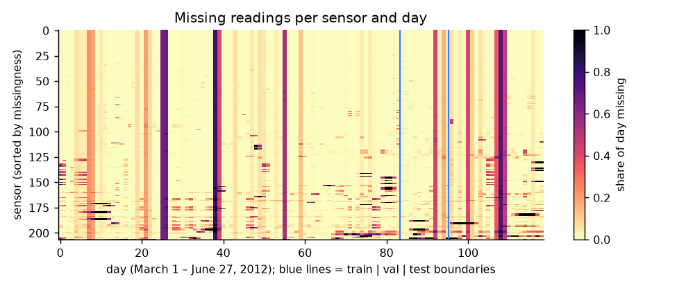
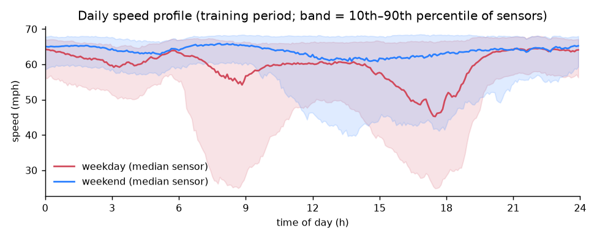
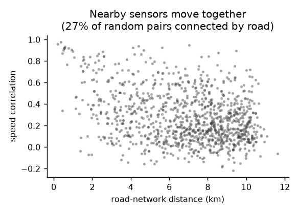
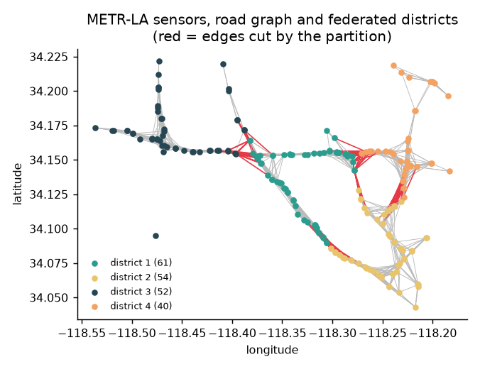
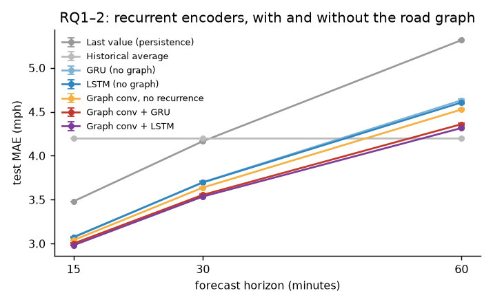
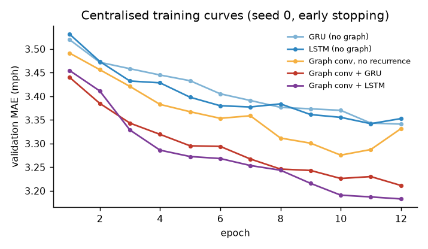
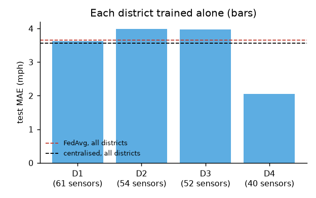
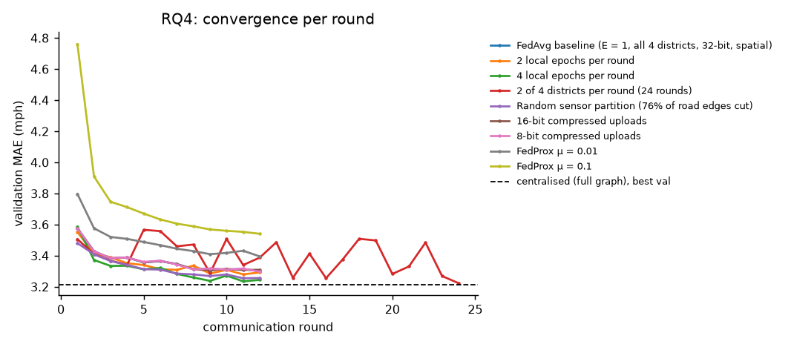
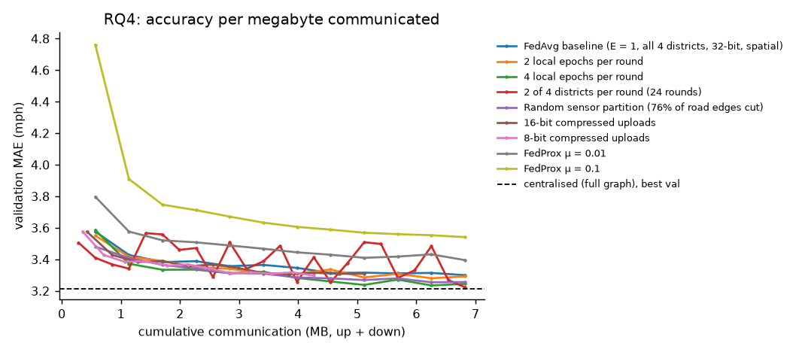
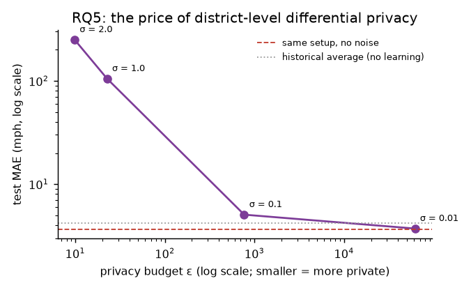

# Federated Spatio-Temporal Traffic Forecasting on METR-LA: Graph-Recurrent Encoders, Communication Trade-offs and the Cost of Privacy

**Keshav Markan** · Bachelor of Computer Science, Conestoga College · November 2026

*Every number in this report is generated from logged runs: §5.1–5.5 by `python -m fedtraffic.report`, and the follow-up analyses in §5.6 by the scripts in `analysis/`. Tables are in `results/tables/`, figures in `results/figures/`, and the run logs (config, git commit, metrics per epoch or round) in `runs/`.*

---

## Abstract

We forecast freeway speeds 15, 30 and 60 minutes ahead at 207 Los Angeles sensors (METR-LA). We compare centralised training with federated learning across four geographic districts that never share raw readings.

**Encoder benchmark** (laptop-CPU budget, 3 seeds):
- Adding a diffusion graph convolution to a recurrent encoder reduces 60-minute MAE by about 6% (GRU 4.63 → 4.36 mph; LSTM 4.61 → 4.32).
- The graph-convolutional LSTM is best at every horizon (2.98 / 3.54 / 4.32 mph).
- At 60 minutes, a simple historical average (4.20) still beats every learned model under this budget. Correcting it with each sensor's recent deviation from its weekly profile lowers this to 4.10 mph, and to 6.06 mph versus the graph LSTM's 7.04 in weekday rush hours.

**Federated learning with Flower:**
- FedAvg reaches 3.654 ± 0.004 mph MAE, 2.8% above centralised training (3.556). It moves 6.8 MB in total.
- Districts training alone do best of all (3.507), and FedProx does worse (3.769). Both point to strong heterogeneity between districts.
- In single-seed sweeps, four local epochs per round or sampling half the districts per round recovers about 2% of the gap, and 8-bit update compression cuts communication by 37% with no accuracy loss.
- District-level differential privacy is unaffordable with four clients: noise giving ε ≈ 10–23 destroys the model.
- A real deployment (one SuperLink, four SuperNode processes) reproduces the simulated validation curve to within 0.0002 mph.

## 1. Introduction

Traffic sensors are often operated by different agencies, and finer-grained mobility data is personal. Training one forecasting model therefore increasingly means training **without pooling raw data**. Federated learning (FL) trains a shared model by exchanging only model updates (McMahan et al., 2017).

Traffic forecasting is spatio-temporal: a sensor's future depends on its own history *and* on upstream and downstream sensors (Li et al., 2018). Federating it raises two specific problems:
- Road links that cross district borders are invisible to every client.
- Districts differ systematically (different freeways, different congestion patterns), so client data is non-IID.

We ask five questions:

- **RQ1:** Which recurrent encoder works better here, GRU or LSTM?
- **RQ2:** How much does the road graph help, and is recurrence still needed once the graph is used?
- **RQ3:** How close does federated training get to centralised training, and does it beat districts training alone?
- **RQ4:** How do local computation, client participation, partitioning and update compression trade accuracy against communication?
- **RQ5:** What does a formal (differential) privacy guarantee cost at this scale?

## 2. Related work

- **Graph models for traffic.**
  - DCRNN (Li et al., 2018) introduced diffusion convolution inside a GRU and released the METR-LA benchmark used here.
  - STGCN and Graph WaveNet replaced recurrence with temporal convolutions.
- **Federated optimisation.**
  - FedAvg averages locally trained weights (McMahan et al., 2017).
  - FedProx adds a proximal term to limit client drift under heterogeneity (Li et al., 2020).
  - For spatio-temporal graphs, CNFGNN (Meng et al., 2021) studied federated learning across sensor nodes.
- **Privacy.** Differentially private federated averaging clips client updates and adds Gaussian noise (McMahan et al., 2018). Rényi DP gives tight composition across rounds (Mironov, 2017).
- **Tooling.** Experiments use the Flower framework (Beutel et al., 2020).

## 3. Data

METR-LA contains average speeds from 207 loop detectors every 5 minutes, from March 1 to June 27, 2012 (34,272 steps), plus pairwise road-network distances. Provenance, licences, checksums and privacy notes are in `DATA_CARD.md`.

**Exploratory findings** (`results/eda.json`):
- **Missing data.**
  - 8.11% of readings are missing, recorded as 0 mph.
  - Most gaps are long outages: only 0.34% of readings fall in gaps of 15 minutes or less.
  - Missingness rises from 7.1% in the training period to 12.1% in the test period (Figure 1).
- **Daily pattern.** Weekday speeds dip sharply in morning (7–9 am) and evening (4–7 pm) rush hours, while weekends stay near free flow (Figure 2).
- **Spatial correlation.** Sensors within 2 km by road correlate at a median 0.74, falling to 0.19 beyond 10 km and 0.16 for pairs with no listed road path (Figure 3). This is the empirical case for a graph model.
- **Graph construction.** A thresholded Gaussian kernel on road distances (σ = the standard deviation of the distances, weights below 0.1 dropped) gives 1,722 non-zero entries, identical to the adjacency released with DCRNN.

| Figure 1: missing readings | Figure 2: daily profile |
|---|---|
|  |  |

| Figure 3: correlation vs road distance | Figure 4: sensors, graph and federated districts |
|---|---|
|  |  |

## 4. Methods

### 4.1 Preprocessing (reproducible pipeline)

All settings live in `configs/default.yaml`. The processed dataset is cached under a hash of those settings and of the raw files' SHA-256 checksums.

- **Split:** chronological 70 / 10 / 20% (train / validation / test). Normalisation statistics and the historical-average fill use the training period only.
- **Missing values:**
  - Gaps of at most 15 minutes are linearly interpolated for model *inputs*.
  - Longer gaps are filled with the training-period mean for that sensor and 5-minute slot of the week.
  - An "observed" flag accompanies every input.
  - **Targets are never filled:** losses and metrics count only real readings.
- **Inputs:** 12 steps (1 hour) × [normalised speed, observed flag, sin and cos of time of day].
- **Outputs:** the next 12 steps (5 to 60 minutes).
- **Compute budget:** to fit a laptop CPU, training uses every 6th window (30 minutes apart, 3,995 windows), and evaluation every 3rd. This is identical for every method.

### 4.2 Models

All learned models map (batch, 12, sensors, 4) to (batch, 12, sensors). Their weights do not depend on the number of sensors, which lets one model serve districts of different sizes.

- **Diffusion convolution** (Li et al., 2018): $\sum_{d\in\{f,b\}}\sum_{k=0}^{K} P_d^k X W_{d,k}$, with forward and backward random-walk matrices $P_f = D_{out}^{-1}W$ and $P_b = D_{in}^{-1}W^\top$, and K = 2 hops. The hop matrices are precomputed as one dense stack, which was 5× faster on CPU than repeated sparse products.
- **Encoders compared:**
  - GRU and LSTM without the graph (one shared cell applied per sensor);
  - a graph-only model (two diffusion convolutions over the flattened hour);
  - graph-convolutional GRU and LSTM (gates are diffusion convolutions).
- **Model settings:** hidden size 32. A linear head maps each sensor's final state to all 12 horizons at once (not autoregressive).
- **Baselines:** last observed value (persistence) and historical average.
- **Training:** Adam (lr 3e-3), masked MAE loss, gradient clipping at 5, up to 12 epochs with early stopping on validation MAE (patience 3).

### 4.3 Federated setup

- **Districts.** Sensors are split into four districts by k-means on coordinates (61 / 54 / 52 / 40 sensors), with a fixed partition seed. This cuts 12.8% of road edges. A random partition (76% cut) serves as a control.
- **Clients.** Each district is one Flower client that sees only its sensors and its subgraph.
- **Rounds.** Each round, sampled clients train for E local epochs from the global weights. FedAvg (or FedProx) then averages them, weighted by number of observations.
- **Communication.** Counted exactly: model size × 4 bytes × clients, both down and up, or less with compressed uploads.
- **Compression.** 16-bit uploads send half-precision updates. 8-bit uploads send a per-tensor min/max plus one byte per value. Both are applied to the update (new − global weights) and restored on the server.
- **Differential privacy (RQ5).**
  - Implemented with Flower's server-side fixed clipping. District updates are clipped to L2 norm C = 3 (typical late-training update norms measured 2.7–3.3), averaged *uniformly*, and Gaussian noise of standard deviation σC/4 is added.
  - We report ε at δ = 1e-5 over 12 rounds via Rényi-DP composition (Mironov, 2017), with no subsampling amplification. The guarantee is district-level.
- **Evaluation.** The final global model runs on each district's own subgraph, as it would be deployed, and errors are pooled over all 207 sensors. Centralised models use the full graph.
- **Two controls isolate the costs of federation:**
  - centralised training on the graph *cut* at district borders (the cost of losing cross-border edges);
  - local-only training (each district alone, no collaboration).

### 4.4 Implementation and reproducibility

- **Stack:** Python 3.12, PyTorch 2.15 (CPU), Flower 1.42 (simulation via Ray 2.55).
- **Hardware:** one AMD Ryzen 7 5825U laptop with no GPU.
- **Run logs:** every run records its configuration, git commit, an uncommitted-changes flag, package versions, seed and per-epoch or per-round metrics.
- **This study:** 40 completed runs on four commits, none with uncommitted changes. One configuration was run in two different sweeps and gave a bit-identical test MAE (3.559956…).
- **Discarded runs:** four runs affected by a partition bug (§7) are kept in `runs_discarded/` rather than deleted.

## 5. Results

### 5.1 RQ1–RQ2: encoders and the road graph

**Table 1.** Test errors (mph) on the centralised full graph; mean ± sd over 3 seeds.

| Model | Params | MAE 15 min | MAE 30 min | MAE 60 min | RMSE 60 min | MAPE 60 min (%) | Train time, median (s) |
|---|---|---|---|---|---|---|---|
| Last value (persistence) | 0 | 3.48 | 4.17 | 5.32 | 10.24 | 14.39 | 0 |
| Historical average | 0 | 4.20 | 4.20 | **4.20** | **7.87** | **13.06** | 0 |
| GRU (no graph) | 4,044 | 3.07 ± 0.00 | 3.70 ± 0.01 | 4.63 ± 0.01 | 9.15 ± 0.02 | 14.13 ± 0.09 | 146 |
| LSTM (no graph) | 5,260 | 3.08 ± 0.01 | 3.70 ± 0.01 | 4.61 ± 0.02 | 9.13 ± 0.03 | 14.15 ± 0.09 | 86 |
| Graph conv, no recurrence | 13,260 | 3.04 ± 0.00 | 3.64 ± 0.01 | 4.53 ± 0.01 | 8.87 ± 0.04 | 13.92 ± 0.13 | 37 |
| Graph conv + GRU | 17,772 | 3.00 ± 0.01 | 3.56 ± 0.01 | 4.36 ± 0.01 | 8.66 ± 0.02 | 13.55 ± 0.11 | 425 |
| Graph conv + LSTM | 23,564 | **2.98 ± 0.00** | **3.54 ± 0.01** | 4.32 ± 0.01 | 8.60 ± 0.04 | 13.33 ± 0.27 | 305 |



- **RQ1.** Without the graph, GRU and LSTM are indistinguishable (overall MAE 3.70 vs 3.69). With the graph, the LSTM is slightly but consistently better at every horizon (3.522 ± 0.005 vs 3.549 ± 0.010 overall). In this implementation it also trained faster.
- **RQ2.** The graph helps every encoder, and most at long horizons. At 60 minutes, adding diffusion convolution reduces MAE by 5.8% for the GRU and 6.3% for the LSTM. The graph-only model sits between the plain recurrent models and the graph-recurrent ones, so recurrence and graph structure are complementary.
- **The models beat persistence** at every horizon, by 14% at 15 minutes.
- **The historical average wins at 60 minutes,** on MAE, RMSE and MAPE. DCRNN reports 3.60 there with full training. Our models are smaller, saw one-sixth of the training windows, and all ran the full 12 epochs without early stopping triggering (Figure 6), so they are under-trained, not saturated. Within this budget, the historical average remains the right baseline to beat for hour-ahead forecasts.



### 5.2 RQ3: federated vs centralised vs local

**Table 2.** Test errors (mph), mean ± sd over 2 model seeds, with the same four districts in every run.

| Setting | MAE 15 min | MAE 30 min | MAE 60 min | MAE (all) | Raw data leaves district? | Comm. (MB) |
|---|---|---|---|---|---|---|
| Centralised, full road graph | 3.01 ± 0.00 | 3.56 ± 0.00 | 4.37 ± 0.00 | 3.556 ± 0.004 | yes | – |
| Centralised, graph cut at district borders | 3.02 ± 0.00 | 3.58 ± 0.00 | 4.40 ± 0.01 | 3.576 ± 0.006 | yes | – |
| **Local only** (each district alone) | **3.00 ± 0.01** | **3.52 ± 0.01** | **4.26 ± 0.01** | **3.507 ± 0.007** | no | 0 |
| Federated: FedAvg | 3.04 ± 0.00 | 3.65 ± 0.00 | 4.55 ± 0.00 | 3.654 ± 0.004 | no | 6.8 |
| Federated: FedProx (μ = 0.01) | 3.12 ± 0.01 | 3.75 ± 0.00 | 4.75 ± 0.00 | 3.769 ± 0.004 | no | 6.8 |

- **Losing cross-border edges is cheap.** The cut graph costs only 0.6% (3.556 → 3.576), consistent with the spatial partition cutting just 12.8% of edges.
- **FedAvg is 2.8% worse than centralised training** after 12 rounds. Since the cut graph explains only 0.6 points of that, most of the gap comes from federated optimisation itself.
- **Each district training alone is the best setting overall** (1.4% better than centralised, 4.0% better than FedAvg). The advantage is largest at 60 minutes (4.26 vs 4.37 vs 4.55).
- **Per district, the local-only errors differ greatly:** 3.63 / 3.99 / 3.97 / **2.05** mph for the 61-, 54-, 52- and 40-sensor districts (Figure 7). A single shared model has to compromise across districts this different.
- **FedProx makes things worse,** and more so as μ grows (§5.3). This fits the same explanation: its proximal term pulls each district *towards* the shared compromise, while here specialisation is what helps.
- **Conclusion for RQ3.** Federated learning keeps raw data local at a cost of 2.8% MAE. On this dataset, collaboration through a single shared model does not beat districts working alone. The natural next step is personalised FL, for example a shared model fine-tuned per district.



### 5.3 RQ4: convergence and communication

**Table 3.** FedAvg variants. Single seed each; across seeds FedAvg varies by ±0.004 mph, so differences of more than about 0.02 are meaningful. The target is validation MAE ≤ 3.366, within 2% of the baseline's final value.

| Variant | Test MAE | Rounds | Total comm. (MB) | Rounds to target | MB to target | Wall time (s) |
|---|---|---|---|---|---|---|
| FedAvg baseline (E = 1, all 4 districts, 32-bit) | 3.658 | 12 | 6.8 | 5 | 2.8 | 230 |
| 2 local epochs per round | 3.640 | 12 | 6.8 | 4 | 2.3 | 403 |
| 4 local epochs per round | 3.586 | 12 | 6.8 | 3 | 1.7 | 736 |
| 2 of 4 districts per round (24 rounds) | **3.569** | 24 | 6.8 | 4 | **1.1** | 320 |
| Random sensor partition (76% of edges cut) | 3.604 | 12 | 6.8 | 3 | 1.7 | 233 |
| 16-bit compressed uploads | 3.667 | 12 | 5.1 | 5 | 2.1 | 238 |
| 8-bit compressed uploads | 3.652 | 12 | **4.3** | 5 | 1.8 | 230 |
| FedProx μ = 0.01 | 3.765 | 12 | 6.8 | not reached | – | 250 |
| FedProx μ = 0.1 | 3.934 | 12 | 6.8 | not reached | – | 301 |

| Figure 8: convergence per round | Figure 9: accuracy per megabyte |
|---|---|
|  |  |

- **More local computation per round** trades compute for communication. Four local epochs reach the target in 3 rounds instead of 5 and end 2.0% better, at 3.2× the wall time.
- **Sampling half the districts per round** with the same total communication (24 rounds) gives the best federated result (3.569), reaching the target with the least data (1.1 MB). Its curve is noisier, because each round sees only half the districts.
- **Update compression is almost free here.** 8-bit uploads cut total communication by 37% (6.8 → 4.3 MB) with no measurable accuracy change (3.652 vs 3.658), and 16-bit by 25%.
- **A random partition does better than the geographic one** (3.604 vs 3.658), even though it cuts 76% of road edges instead of 12.8%. Random districts each contain a mix of all freeways and are therefore less heterogeneous. Together with §5.2, this suggests that **client heterogeneity, not missing graph edges, is the main obstacle to FedAvg here.**
- **Scale of the communication.** All 12 rounds of FedAvg move 6.8 MB in total. For comparison, the raw training-period speeds of all 207 sensors are 19.9 MB as float32. Federated training does not need to be more expensive to transmit than sharing the data.

### 5.4 RQ5: the cost of differential privacy

**Table 4.** Central DP at the district level, 12 rounds, δ = 1e-5.

| Setting | σ | ε | Test MAE | MAE 60 min |
|---|---|---|---|---|
| Uniform averaging, no clipping or noise (control) | 0 | ∞ | 3.658 | 4.56 |
| Central DP, C = 3 | 0.01 | 61,751 | 3.713 | 4.66 |
| Central DP, C = 3 | 0.1 | 766 | 5.063 | 6.56 |
| Central DP, C = 3 | 1.0 | 22.6 | 104.9 | 92.0 |
| Central DP, C = 3 | 2.0 | 9.8 | 250.2 | 212.8 |



Only noise levels that give no meaningful privacy (ε in the hundreds or more) keep the model usable. At σ = 0.1 it is already worse than the historical average.

The reason is scale. The noise on the averaged update has standard deviation σC/4 on each of 17,772 weights, so its norm is roughly 33σC, against a typical update norm of about 3. Central DP relies on averaging over many participants to drown out the noise, and four districts are far too few. Local DP, where each district adds its own noise, would be worse still.

**Conclusion for RQ5.** In a setting with a handful of agencies, federated learning alone offers data minimisation (raw readings stay local) but **no formal privacy guarantee**. A formal guarantee requires many more participants, such as per-vehicle or per-sensor clients, or cryptographic tools such as secure aggregation.

### 5.5 Simulation vs real deployment

The same ClientApp and ServerApp were run as a real Flower federation: one SuperLink and four SuperNode processes communicating over HTTP on localhost (`deploy/run_local.py`).

**Table 5.** Validation MAE per round, simulation vs deployment.

| Round | Simulation (Ray) | Deployment (SuperLink + 4 SuperNodes) |
|---|---|---|
| 1 | 3.5755 | 3.5755 |
| 2 | 3.4283 | 3.4283 |
| 3 | 3.3829 | 3.3831 |

The curves agree to within 0.0002 mph. The remaining difference is consistent with the deployment using 2 CPU threads per client instead of 4, which changes floating-point summation order. Three rounds took 119 s.

### 5.6 Follow-up analyses

These were added after the main study and use its data, splits and logged runs. They are generated by the scripts in `analysis/`.

**Seasonal-residual forecaster.** The historical average ignores what traffic is doing right now. The forecaster predicts each sensor's training-period weekly profile, plus a weighted mean of its deviation from that profile over the last few observed readings. The lookback (1, 3, 6 or 12 steps) and weight (0 to 1 in steps of 0.05) are chosen per horizon on validation data only. It uses no future information and has no trained parameters.

**Table 6.** Test MAE (mph) of the seasonal-residual forecaster (`results/tables/day008_seasonal_results.csv`).

| Horizon | Lookback (steps) | Weight | Historical average | Seasonal-residual | Graph conv + LSTM (Table 1) |
|---|---|---|---|---|---|
| 15 min | 3 | 0.80 | 4.196 | 3.370 | **2.98** |
| 30 min | 3 | 0.65 | 4.196 | 3.763 | **3.54** |
| 60 min | 3 | 0.45 | 4.197 | **4.104** | 4.32 |

At 15 and 30 minutes the graph LSTM is clearly better. At 60 minutes the seasonal-residual forecaster is the best method in this study.

**Where the 60-minute gap comes from.** The seed-0 graph LSTM was retrained from its logged configuration. The script checks that it reproduces the logged 60-minute test MAE (4.3281). Both models were then scored on the same test windows and observed readings, by district and by period. Rush hour uses the dataset clock: weekdays 07:00–10:00 and 16:00–19:00.

**Table 7.** Paired 60-minute test MAE (mph), graph LSTM vs seasonal-residual (`results/tables/day008_district_results.csv`).

| District | Sensors | Rush: LSTM | Rush: seasonal | Other: LSTM | Other: seasonal |
|---|---|---|---|---|---|
| All | 207 | 7.045 | **6.064** | 3.641 | **3.608** |
| 1 | 61 | 7.885 | **6.802** | **3.685** | 3.920 |
| 2 | 54 | 7.953 | **6.505** | 4.223 | **4.055** |
| 3 | 52 | 8.220 | **7.169** | 4.228 | **3.986** |
| 4 | 40 | 3.100 | **2.978** | **2.055** | 2.059 |

Almost all of the gap is in rush hours, where the seasonal-residual forecaster is 1.0–1.4 mph better in every district except the free-flowing district 4. Outside rush hours the two are within 0.25 mph, and the LSTM wins in district 1. The weekly profile encodes recurring congestion that the under-trained LSTM (§5.1) has not learned from a 12-step input window. This suggests giving the neural model the time-of-week profile as an input, or training it on the residual, rather than training it longer.

**Communication budgets.** §5.3 measured the communication needed to reach one target. `paper/communication_budget.md` asks instead which of seven logged FedAvg configurations has the lowest validation MAE when training must stop at a fixed budget (0.5–7 MB), taking the last round that fits with no retrospective checkpoint selection. Half participation leads at four of six budgets and four local epochs at the other two. This is descriptive: each modified configuration has one seed, the budget grid was chosen after the runs, and the scores are on validation data.

## 6. Discussion

- **For forecasting,** graph-recurrent encoders are clearly better than recurrent-only ones on short and medium horizons, and the LSTM variant is marginally best.
- **For federation,** the decisive property of this dataset is heterogeneity between districts, not the loss of cross-border edges:
  - local-only training beats FedAvg;
  - a random (more homogeneous) partition beats a geographic one despite cutting six times more edges;
  - FedProx, which suppresses drift towards local optima, hurts.
- **For practitioners:**
  - prefer personalisation over a single global model;
  - spend extra compute on more local epochs rather than more rounds when communication is the bottleneck;
  - compress uploads, since 8-bit costs nothing measurable here.
- **For hour-ahead forecasts,** a seasonal profile corrected by recent deviations is a strong, cheap baseline. It is also trivially federated, since each sensor needs only its own history. Its advantage over the neural model is concentrated in rush hours (§5.6).

## 7. Limitations

- **Compute budget.** Models are small (hidden size 32), trained on one-sixth of the windows for at most 12 epochs, and never early-stopped. Absolute errors are therefore well above the published state of the art (DCRNN: 2.77 / 3.15 / 3.60), and the historical average beats every learned model at 60 minutes. Conclusions are about *relative* comparisons under one shared budget.
- **Few seeds.** The benchmark uses 3 seeds and the federated comparison 2. The trade-off and privacy sweeps use one seed each, which is enough for large effects but not for differences of about 0.01 mph.
- **One dataset and one partition granularity** (4 districts). With more clients the heterogeneity and DP conclusions may change. PEMS-BAY is the natural replication.
- **Non-autoregressive decoder.** One linear head predicts all 12 steps, which is simpler but weaker than DCRNN's sequence-to-sequence decoder.
- **Follow-up analyses (§5.6)** were designed after the main results were known. The seasonal-residual settings were chosen on validation data only, but the paired district comparison uses one LSTM seed, and the communication-budget comparison is validation-only and single-seed.
- **Privacy accounting** assumes full participation and uniform averaging. It covers model updates only, not validation metrics.
- **Process issues, documented in `RESEARCH_LOG.md`.**
  - A first version derived the district partition from the model seed, and one seed produced a district of a single sensor. The four affected runs were discarded (and kept in `runs_discarded/`) and rerun with a fixed partition seed.
  - A laptop suspend stretched one benchmark run to 2 hours without affecting its result. Reported training times are medians.

## 8. Ethics and data stewardship

- **No personal data.** METR-LA contains aggregate speeds, not individuals.
- **Raw data is not redistributed.** The pipeline downloads it from public mirrors, verifies SHA-256 checksums, and reads the HDF5 file without unpickling anything.
- **Missing readings are never scored as truth,** and the test period is never used for model selection.
- **The privacy claims are deliberately narrow.** Federated learning here minimises data movement but is not a privacy guarantee (§5.4).
- **Intended use.** A 2012 dataset should not drive real traffic operations; this is research and education.

See `DATA_CARD.md`.

## 9. Reproducing this report

```powershell
uv venv --python 3.12 .venv
uv pip install --python .venv\Scripts\python.exe -r requirements.txt
.venv\Scripts\python -m fedtraffic.eda                      # data download, checks, figures 1–4
.venv\Scripts\python -m fedtraffic.experiments benchmark    # RQ1–2
.venv\Scripts\python -m fedtraffic.experiments federated    # RQ3
.venv\Scripts\python -m fedtraffic.experiments tradeoffs    # RQ4
.venv\Scripts\python -m fedtraffic.experiments privacy      # RQ5
.venv\Scripts\python deploy\run_local.py                    # real Flower deployment
.venv\Scripts\python -m fedtraffic.report                   # every table and figure in §5.1–5.5
.venv\Scripts\python analysis\day008_seasonal_residual.py data\processed\metr-la-828dd9de4670.npz results\tables\day008_seasonal_results.csv
.venv\Scripts\python analysis\day008_district_evaluation.py . results\tables\day008_district_results.csv   # retrains the LSTM, ~5 min
.venv\Scripts\python analysis\day008_budget_analysis.py . results\tables\day008_budget_results.csv
```

## References

- Beutel, D. J., et al. (2020). Flower: A friendly federated learning research framework. arXiv:2007.14390.
- Jagadish, H. V., et al. (2014). Big data and its technical challenges. *Communications of the ACM*, 57(7).
- Li, T., Sahu, A. K., Zaheer, M., Sanjabi, M., Talwalkar, A., & Smith, V. (2020). Federated optimization in heterogeneous networks. *MLSys*.
- Li, Y., Yu, R., Shahabi, C., & Liu, Y. (2018). Diffusion convolutional recurrent neural network: Data-driven traffic forecasting. *ICLR*.
- McMahan, H. B., Moore, E., Ramage, D., Hampson, S., & Agüera y Arcas, B. (2017). Communication-efficient learning of deep networks from decentralized data. *AISTATS*.
- McMahan, H. B., Ramage, D., Talwar, K., & Zhang, L. (2018). Learning differentially private recurrent language models. *ICLR*.
- Meng, C., Rambhatla, S., & Liu, Y. (2021). Cross-node federated graph neural network for spatio-temporal data modeling. *KDD*.
- Mironov, I. (2017). Rényi differential privacy. *IEEE CSF*.
